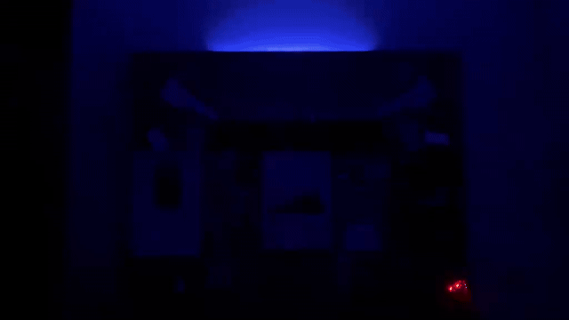
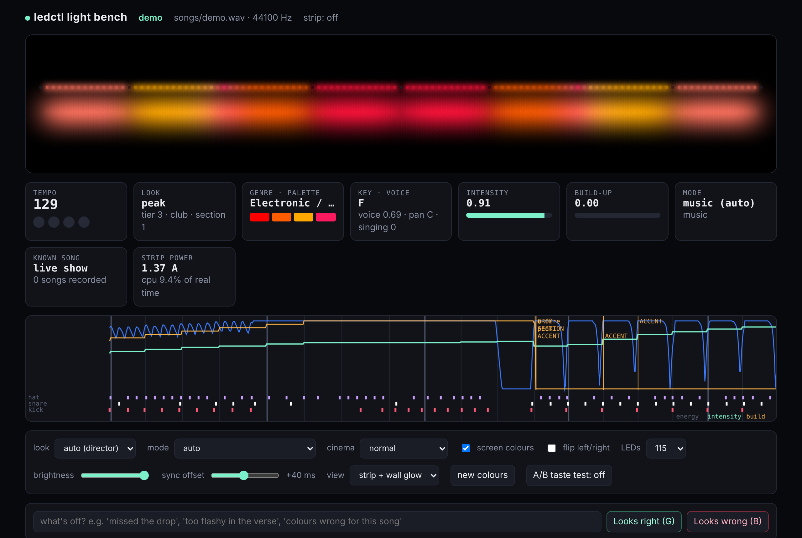
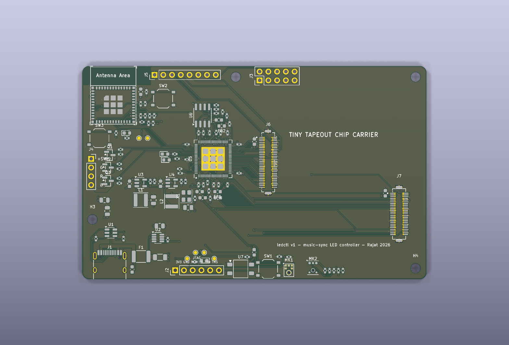
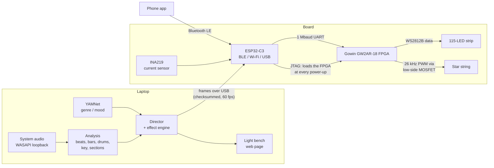
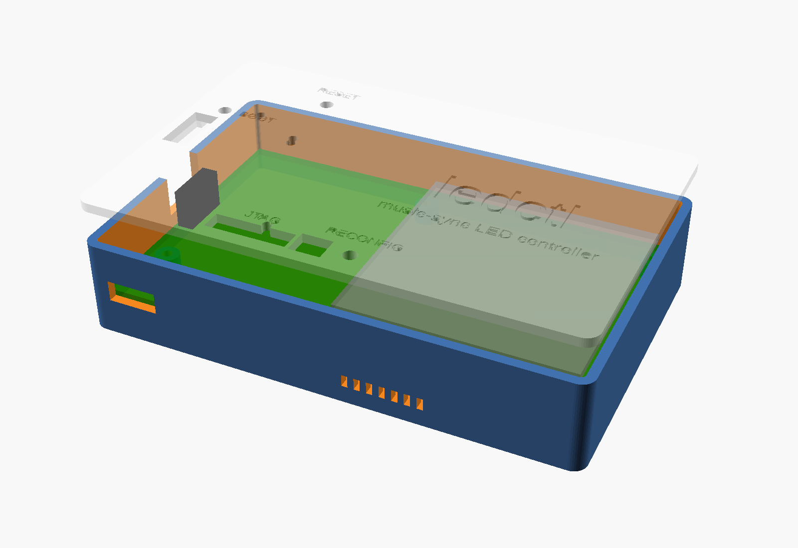
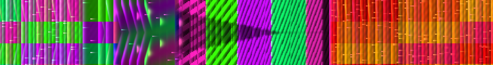

# ledctl: an FPGA music-sync LED controller

A board I designed from scratch that turns music into a light show on a 115-LED addressable strip.
The laptop listens to what's playing (Spotify or anything else), works out the beat, the bars, the drums,
the genre and where the song is going (build-up, drop, breakdown), and a lighting "director" picks looks the
way a club lighting operator would. Every frame goes to the board, and the FPGA drives the strip.

It spans the whole stack: a 4-layer PCB, FPGA logic, ESP32 firmware, real-time audio analysis and a phone app.

**Built with:** KiCad · Verilog (Yosys, nextpnr, Icarus) · ESP32-C3 (C++, Arduino) · Python (NumPy, ONNX
Runtime) · Android (Java) · OpenSCAD

<p align="center"></p>

*The strip around my pinboard, synced to a song: the build-up, one dark beat, then the drop.*





*The ledctl v1 board: 100 × 62 mm, 4 layers, assembled by JLCPCB.*

---

## What it does

- **Lights it like a club LJ, not a VU meter.** The beat goes into movement and colour (bars snapping to
  new positions, colours bouncing between two opposite hues, sweeps, step chases) while brightness only
  follows the size of the section. The strip is treated as 8 virtual fixtures; one base colour, one moving
  layer and at most one accent at a time.
- **Knows the shape of a song.** Looks hold for a phrase and vary every 4 bars. Build-ups close in from the
  ends and double their step rate, the beat before a drop goes dark, and the drop hits on the beat.
- **Plans songs it has heard before.** Every song is recorded locally and analysed offline (beats, bars,
  sections, drops). When it plays again, the live audio is matched against the recording (one FFT over the
  whole song, level-independent, follows seeks), so drops land exactly and the build-up starts on time.
- **Colours follow the harmony.** A neural network ([YAMNet](https://tfhub.dev/google/yamnet/1)) picks the
  colour family (R&B, hip-hop, EDM, pop, rock, chill), the key picks the palette, and the bass note's place
  in the key picks which colour leads, so the same song always gets the same colours and they move with the
  chords. No white: grey and white are never sent to the strip.
- **Cinema mode for films, YouTube and games.** It switches automatically when it hears speech or film
  sounds, and stays there while a video site or player is in front. The strip takes the scene's main
  colours from the laptop screen, the way Hue Sync lights a room (or edge by edge, Ambilight-style, for
  a strip around the screen); white becomes a dim tint. Dialogue keeps it calm, the score swells it, music
  with a beat sends waves on the beat, and explosions send one accent in the scene's own colour.
- **A second light with its own role.** A plain (non-addressable) star string on the board's spare MOSFET
  output, dimmed by the FPGA and used like a club rig's extra lamps: almost off in verses, kick hits with a
  warm afterglow, a strobe that speeds up through the build-up, alone at full on the dark beat (a
  blinder), then pumping against every kick after the drop. In films: lightning on impacts.
- **Learns your taste.** An A/B mode shows two versions of the same moment side by side. Your picks are
  saved per genre and the director follows them.
- **Runs without the laptop.** The phone app (Bluetooth) and the board's own modes (solid, breathe, party,
  study timer, ...) work on their own.

## How it fits together



| Part | Job |
|---|---|
| **Gowin GW2AR-18 FPGA** | WS2812B driver, double-buffered frame memory, command parser, audio front end (I2S mic, filter bank, beat detector) |
| **ESP32-C3** | Configures the FPGA over JTAG at boot, Bluetooth LE and Wi-Fi control, USB link to the laptop, current limiting |
| **INA219** | Measures the strip's current; the firmware scales frames down if it goes over the limit |
| **Laptop (Python)** | The music brain: analysis, genre network, director, light bench, scoring and tuning tools |

## The hardware

- 4-layer, 100 × 62 mm board, designed in KiCad. ERC/DRC clean.
- Gowin GW2AR-LV18 (QN88), ESP32-C3-MINI-1, 27 MHz clock, 2 MB SPI flash, INA219 current sensor,
  I2S MEMS mic + analog mic, three MOSFET strip outputs, USB-C with ESD protection and a 2.6 A fuse.
- A socket for a [Tiny Tapeout](https://tinytapeout.com) chip, for the phase-2 plan of designing my own
  analog front end in silicon.
- Fab files (Gerbers, BOM, pick-and-place) in [`hardware/fab`](hardware/fab), and a 3D-printable
  enclosure in [`hardware/enclosure`](hardware/enclosure).



## The FPGA design ([`fpga/v2`](fpga/v2))

- **WS2812B driver.** 800 kHz, GRB, cycle-exact at 27 MHz (0.41 / 0.81 µs high times, 1.26 µs bits,
  300 µs latch). Output straight from an FPGA pin.
- **Frame packets** from the ESP32 at 1 Mbaud: `0xA7, n_lo, n_hi, n × RGB`, written into one bank of a
  double-buffered block RAM while the other bank is shown. The parser resyncs after a gap.
- **Fallback.** With no frames for 1 s the strip shows the board's own colour, so the phone modes keep
  working.
- **UART input with a glitch filter** (the line only changes after 5 equal samples) against crosstalk from
  the strip pins next to it.
- **Star PWM** on two spare MOSFET outputs: set by a 5-byte command, 8-bit duty at ~26 kHz from a
  set/reset flop, forced off when frames stop. The laptop sends the level as one extra pixel after the
  strip, and the ESP32 turns it into the command.
- **Diagnostics in the telemetry:** packets received, strip refreshes sent, the star levels the FPGA holds,
  and its live flags (frames arriving, strip mode, the state of each output pin). The laptop shows them all,
  so the whole path from the music brain to an output pin can be checked without a scope.
- The v1 audio front end is still in there: I2S receiver, IIR 3-band filter bank with log envelopes,
  beat detector, telemetry to the ESP32 every 10 ms.
- Open toolchain only: Yosys, nextpnr-himbaechel, gowin_pack. Testbenches in Icarus Verilog
  (`tb_ws.v`, `tb_boot.v`, `tb_glitch.v`, `tb_stars.v`). About 28% of the FPGA's LUTs.

## The music brain ([`laptop/musicbrain`](laptop/musicbrain))

**Analysis** (`analysis.py`, all causal, ~10 ms hops, about 1 ms per hop):
- 40 mel bands, each normalised to its own recent range
- kick / snare / hi-hat detectors on per-band spectral flux with adaptive thresholds
- tempo from an autocorrelation with harmonic scoring and a genre-aware prior; beat phase from a PLL on a
  continuous beat position, so corrections never add or drop beats
- bar lines from chord changes, bass-note changes and kicks, minus backbeat snares
- key (Krumhansl), lead pitch, voice level and stereo position
- sections from novelty spikes on downbeats; build-ups from steady rises with the bass held back;
  drops from the kick and full bass returning
- a harmonic/percussive split (median filtering over time), stereo balance, risers (rising, noisier top
  end) and impacts (big broadband hits)

**Director and effects** (`show.py`): 12 looks (wash, bass floor, colour bounce, stripes, sweep, step
chase, scanners, stereo split, punch, swell, peak, build) in three styles (smooth, punchy, club), chosen
by the size of the music and held for phrases; snare wipes and impact ripples as rate-limited accents;
harmony-driven colours; brightness per section; hue-preserving limits and a power limit for the strip.
This file is also the reference model for moving the effect engine into the FPGA.

**Known songs** (`songmap.py`): finds the position in a recorded song by cosine similarity of the
spectral shape at every offset (one FFT), locks after two agreeing matches (about 10 s, ~3 ms error),
and lays the song's real beat grid, sections and upcoming drops over the live analysis.

**Cinema** (`cinema.py`): screen capture through GDI (no extra installs); in the room layout the scene's
2-3 main colours from a saturation-weighted hue histogram, eased around the colour wheel (never through
grey); in the screen layout one colour per screen edge; cut-aware smoothing; sound states (dialogue,
score, music on the beat) smoothed over seconds with hysteresis; impact accents; subtle, normal and
intense settings; a black (DRM-protected) picture falls back to mood colours.

**Teaching it:**
- **Light bench:** a web page with a virtual strip, a 10 s timeline of what the brain heard, and
  "looks right / looks wrong" buttons that save the last 10 s of state.
- **A/B taste test:** two strips, one thing different, blind left/right; picks are saved per genre.
- **Scoring:** `truth.py` works out reference beats and bar lines offline with
  [Beat This!](https://github.com/CPJKU/beat_this) and sections from self-similarity; `tools/score.py`
  replays recordings through the live brain and scores it, and `tools/tune.py` searches its settings.



*A build-up and drop on a synthetic test track, drawn as the strip over time (left to right = 40 s → 70 s,
LEDs top to bottom): mirrored sweeps in the verse; in the build-up the lights close in from the ends while
the steps speed up and the colours spin; one dark beat; then the drop: mirrored blocks changing colour on
every beat with scanners crossing over them.*

## Bring-up: what broke and how I fixed it

The full log is in [`docs/bringup.md`](docs/bringup.md). The short version:

1. **The FPGA's flash couldn't be written** through the programmer. I wrote a JTAG loader for the ESP32
   from Gowin's programming spec, so the board loads the FPGA itself at every power-up.
2. **Music mode didn't react:** an unsigned subtraction bug in the FPGA's loudness filter.
3. **The room fan triggered fake beats:** a gated Kalman filter that learns each band's noise floor.
4. **Spotify shut down its audio-analysis API**, so the laptop analyses its own audio output instead.
5. **The first LED died** during wiring (a mixed-up ground and data line), freezing the whole strip.
   Lesson: ground first, data last.
6. **Strip signal vs. serial link.** The MOSFET output was too slow for the strip at normal drive
   strength, and at high drive its edges corrupted the ESP32 → FPGA link on the neighbouring pin. Moved
   the strip to a direct FPGA pin and added the counters that proved it.
7. **Random colours on the strip but not on screen:** the ESP32's USB receive buffer overflowed at
   18 KB/s. A bigger buffer plus a checksum on every frame fixed it.
8. **The star lights never lit** (except for a second at every power-up). The board's current sensor showed
   no extra draw even at 100%, so I added read-back at every stage (laptop → ESP32 → FPGA register → pin).
   Every stage was right, so the fault was past the board: the wire was on J2 pin 5, the FPGA's JTAG data
   output, which only toggles while the ESP32 loads the FPGA. That also explained the flash at power-up.

## Status and next steps

**Working:** the board, FPGA strip driver, ESP32 firmware, phone app, laptop music brain over USB or
Bluetooth, the LJ-style effect engine, pre-planned shows for known songs, cinema mode, the star string on the
kick, light bench, genre network, A/B taste learning.

**Next:**
- Run the scoring and tuning on a set of recorded songs
- Move the effect engine from Python into the FPGA (`show.py` is the reference model), so the laptop only
  sends a few features per frame
- Firmware updates over Bluetooth (move the FPGA image into its own flash partition first)
- A small int8 beat-detection network on the FPGA for a stand-alone, mic-only mode

## Repository layout

```
hardware/   KiCad project, fab files, enclosure
fpga/       v1 (audio front end) and v2 (strip driver) Verilog, constraints, testbenches
firmware/   ESP32-C3 Arduino sketch, FPGA bitstream converter
android/    phone app (built without Gradle)
laptop/     musicbrain: the laptop music brain (Python)
tools/      DSP tuning simulations
docs/       bring-up log, images
```

## Building

**FPGA** (needs `yowasp-yosys`, `yowasp-nextpnr-himbaechel`, `gowin_pack` from Apicula):
```sh
cd fpga/v2 && ./build.sh            # -> ledctl_v2.fs
```

**Firmware** (Arduino core for ESP32 3.3.x, board "ESP32C3 Dev Module", USB CDC on boot, partition
scheme "Huge APP"):
```sh
python firmware/tools/fs2h.py fpga/v2/ledctl_v2.fs firmware/ledctl/fpga_bits.h   # embed the bitstream
arduino-cli compile --fqbn esp32:esp32:esp32c3:CDCOnBoot=cdc,PartitionScheme=huge_app firmware/ledctl
```

**Music brain** (Windows, Python 3.13):
```sh
cd laptop/musicbrain
pip install numpy pyaudiowpatch onnxruntime pyserial bleak
python brain.py            # opens the light bench at http://localhost:8766
```

**Wiring the strip:** strip GND → J2 pin 2, strip 5V → J4 pin 1, strip DIN → J3 pin 3 (FPGA pin 48).
Connect ground first.

## Credits and licences

My own work is under the MIT licence ([LICENSE](LICENSE)).
`laptop/musicbrain/ml/yamnet.onnx` is Google's YAMNet, converted to ONNX, under the Apache 2.0 licence.
Beat This! (CPJKU) is used offline for reference beats and is not included.

Rajat Gupta, NUS Electrical Engineering
